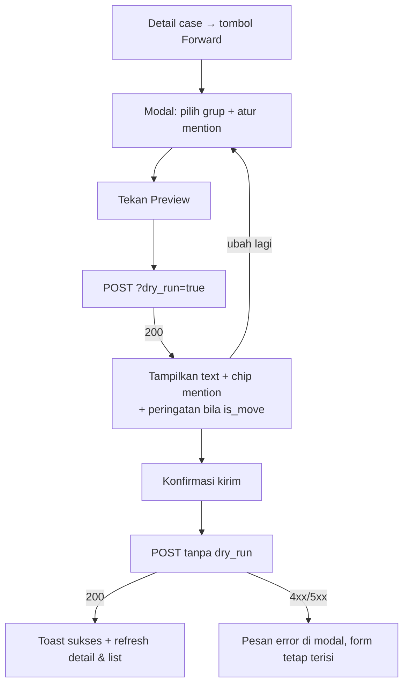

# Panduan FE: Forward / Kirim Ulang Case (v1.37)

Dokumen ini **mandiri** — semua yang dibutuhkan untuk membangun fitur ini ada di sini. Tidak perlu membaca `API-contract-frontend.md` atau dokumen lain.

---

## 1. Apa yang dibangun

Satu endpoint untuk mengirim ulang case yang sudah ada:

```
POST /api/cases/{case_id}/forward
POST /api/cases/{case_id}/forward?dry_run=true   ← preview, tanpa kirim & tanpa ubah DB
```

| Body `group_id` | Mode | Efek |
|---|---|---|
| diisi dan **beda** dari `case.group_id` | **Pindah grup** | case dikirim ke grup baru; `status` → `open`; `reminder_count`/`last_reminder_at` di-reset; `ack` di-reset; tracking grup lama berhenti |
| kosong **atau** sama dengan `case.group_id` | **Kirim ulang di grup yang sama** | pesan/mention/anchor diperbarui; status & reminder **tidak** berubah |

Batasan yang harus tercermin di UI:

- Selalu **mengirim pesan baru** ke WhatsApp. Bubble lama tidak diedit/dihapus — jangan sediakan tombol "edit pesan".
- Endpoint **tidak idempoten**: dua request = dua pesan di grup. Disable tombol selama request.
- "Edit tag" = mode grup sama. "Forward ke tim lain" = mode pindah grup.

---

## 2. Base URL, auth, format error

| Item | Nilai |
|---|---|
| Base URL produksi | `https://api.stc.syfa.site` |
| Path API | `/api/...` (frontend boleh memakai path relatif lewat reverse proxy) |
| Auth | header `X-API-Key: <key>` di **setiap** request |
| Content-Type | `application/json` untuk POST |

Format error seragam:

```jsonc
// error dari endpoint (401/400/404/409/422 logika/429/502)
{ "detail": "group_id 99 tidak dikenal — pakai ID dari GET /api/groups" }

// 422 validasi body (tipe field salah, mis. group_id: "abc")
// bentuk asli FastAPI — ada juga key "input"
{ "detail": [ { "type": "int_parsing", "loc": ["body", "group_id"],
                "msg": "Input should be a valid integer, unable to parse string as an integer",
                "input": "abc" } ] }
```

`detail` bisa **string atau array**. Helper pembaca error harus menangani keduanya:

```js
async function errMessage(resp) {
  const body = await resp.json().catch(() => ({}));
  const d = body.detail;
  if (Array.isArray(d)) return d.map(e => `${e.loc?.slice(1).join(".")}: ${e.msg}`).join("; ");
  return d || `Request gagal (${resp.status})`;
}
```

---

## 3. Data yang perlu disiapkan sebelum membuka modal

### 3.1 Detail case — `GET /api/cases/{id}`

Ambil saat halaman detail dibuka. Field yang dipakai fitur ini:

```jsonc
{
  "case": {
    "id": 42,
    "case_code": "INC000023470570",
    "status": "in_progress",              // open | in_progress | done
    "group_id": 1,                        // grup case sekarang
    "group_name": "Grup A",
    "mentions": [                         // bisa null
      { "number": "628111111111", "name": "Mas Habib" }
    ],
    "fields": { "ticket_remedy": "INC000023470570", "order_id": "ORD-1",
                "no_indihome": "0211234567", "detail_case": "..." },
    "message_text": "punten rekan @628111111111 ...",
    "wa_message_id": "true_120363001@g.us_...",
    "ack": "READ"                          // PENDING | SERVER | DEVICE | READ | null
  },
  "messages": [ /* timeline, tidak dipakai fitur ini */ ],
  "updates": [],
  "participants": []
}
```

Case yang sudah di-soft-delete → `404 { "detail": "Case not found or already deleted" }`.

### 3.2 Daftar grup tujuan — `GET /api/groups`

```jsonc
[
  { "id": 1, "name": "Grup A", "chat_id": "120363001@g.us",
    "is_active": true, "is_default": false, "created_at": "...", "updated_at": "..." },
  { "id": 2, "name": "Grup B", "chat_id": "120363002@g.us",
    "is_active": true, "is_default": false, "created_at": "...", "updated_at": "..." }
]
```

- Aman dipakai langsung: hanya grup **aktif** dan **bukan default**.
- Grup default (biasanya grup test) **tidak muncul**. Kalau `case.group_id` menunjuk grup default, opsi "grup saat ini" tidak ada di list — jangan dipaksakan. Untuk kirim ulang di grup default, kirim body **tanpa `group_id`**.
- Jangan sediakan input `chat_id` bebas: grup tujuan wajib sudah terdaftar agar balasan solver ter-track.

### 3.3 Daftar solver — `GET /api/solver-contacts?is_active=true`

```jsonc
[
  { "id": 7, "name": "Mas Habib", "phone_number": "628111111111",
    "role": "Solusi 1", "is_active": true, "created_at": "...", "updated_at": "..." }
]
```

Dipakai untuk dropdown mention. Nilai yang dikirim ke endpoint adalah `phone_number` (format `62…`, tanpa `+`).

---

## 4. Pemanggilan endpoint

### Request

```jsonc
{
  // Opsional. Kosong / sama dengan grup case = kirim ulang di grup yang sama.
  "group_id": 2,

  // Opsional. Diisi = MENGGANTI seluruh daftar mention (bukan menambah).
  // Kosong/tidak dikirim = pakai case.mentions yang tersimpan.
  "mentions": [{ "number": "6282222222222", "name": "Budi" }],

  // Opsional. Kosong = header default ("punten rekan @<nomor> ...").
  // "{phone}" hanya boleh dipakai bila mentions tidak kosong (kalau tidak → 422).
  "custom_header": null,

  // Opsional. PARTIAL MERGE: kirim hanya key yang diubah.
  "fields": { "detail_case": "Diteruskan dari Grup A, mohon dibantu" }
}
```

Aturan penting:

| Aturan | Konsekuensi kalau salah |
|---|---|
| `mentions` **REPLACE**, bukan merge | Kirim hanya chip baru → tag lama hilang dari pesan |
| Seed modal dari `case.mentions` | Modal mulai kosong = semua tag terhapus saat submit |
| `mentions: []` valid | Pesan jadi tanpa sapaan/header `punten rekan @...` — beri warning |
| `undefined` ≠ `[]` | `undefined` = pakai mention lama; `[]` = hapus semua |
| `fields` partial | Kirim `{detail_case: "..."}` saja; field lain dipertahankan |
| `title` case ikut dihitung ulang dari `detail_case` | — |
| Token `@628…` / `@081…` / `@+62 …` yang diketik di teks otomatis jadi mention | Tidak perlu tambah manual ke array |
| Nomor selalu `62…` tanpa `+` | Mention tidak nge-tag kalau format salah |

### Query `dry_run`

| Nilai | Perilaku |
|---|---|
| `false` (default) | Kirim ke WA + update DB |
| `true` | Hanya render. **Tidak** kirim WA, **tidak** tulis DB. Dipakai untuk preview konfirmasi |

### Contoh cURL

```bash
curl -X POST "https://api.stc.syfa.site/api/cases/42/forward?dry_run=true" \
  -H "X-API-Key: $API_KEY" \
  -H "Content-Type: application/json" \
  -d '{"group_id": 2,
       "mentions": [{"number": "6282222222222", "name": "Budi"}],
       "fields": {"detail_case": "Diteruskan dari Grup A"}}'
```

### Response `200` (kirim sungguhan)

```jsonc
{
  "ok": true,
  "dry_run": false,
  "case_id": 42,
  "case_code": "INC000023470570",
  "group_id": 2,
  "group_name": "Grup B",
  "previous_group_id": 1,
  "is_move": true,
  "status": "open",            // status case setelah operasi
  "status_reset": true,
  "reminder_reset": true,
  "wa_message_id": "true_120363002@g.us_3EB0...",
  "mentions": [{ "number": "6282222222222", "name": "Budi" }],
  "text": "punten rekan @6282222222222 mohon bantuannya untuk case Non AO ada 1 case lagi\n\n#STC_Non AO\n..."
}
```

### Response `200` (`dry_run=true`)

```jsonc
{
  "ok": true,
  "dry_run": true,
  "case_id": 42,
  "case_code": "INC000023470570",
  "group_id": 2,
  "group_name": "Grup B",
  "previous_group_id": 1,
  "is_move": true,
  "mentions": [{ "number": "6282222222222", "name": "Budi" }],
  "text": "punten rekan @6282222222222 ..."
}
```

Tidak ada `wa_message_id`/`status` di mode preview — jangan dibaca.

`text` = pesan final persis yang dibaca grup. Tampilkan apa adanya dengan `white-space: pre-wrap`.

---

## 5. TypeScript

```ts
type Mention = { number: string; name?: string | null };

interface ForwardRequest {
  group_id?: number | null;          // kosong/sama = kirim ulang grup sama
  mentions?: Mention[];              // REPLACE; undefined = pakai mention lama
  custom_header?: string | null;
  fields?: Record<string, unknown>;  // partial merge
}

interface ForwardPreview {
  ok: true; dry_run: true;
  case_id: number; case_code: string | null;
  group_id: number; group_name: string;
  previous_group_id: number | null;
  is_move: boolean;
  mentions: Mention[];
  text: string;
}

interface ForwardResult extends Omit<ForwardPreview, "dry_run"> {
  dry_run: false;
  status: "open" | "in_progress" | "done";
  status_reset: boolean;
  reminder_reset: boolean;
  wa_message_id: string;
}
```

---

## 6. Alur UI



Langkah:

1. Buka modal → isi dropdown grup dari §3.2, mention dari §3.3, seed mention dengan `case.mentions`.
2. Tandai grup asal jika ada di list (`group_id === case.group_id`).
3. Preview (`dry_run`) → tampilkan `text`, chip `mentions`, dan peringatan bila `is_move`.
4. Kirim → sukses → refresh `GET /api/cases/{id}` dan list case.
5. Tutup modal, reset state.

### Copy konfirmasi

**Pindah grup** (`group_id` ≠ `case.group_id`):

> **Pindahkan case ke "Grup B"?**
> Case dikirim ulang ke Grup B dan **pindah** ke sana.
> • Status kembali **open**, penghitung reminder di-reset.
> • Balasan di **Grup A tidak lagi ter-link** ke case ini (histori lama tetap tersimpan).
> • Untuk sekadar mengoreksi tag, pilih grup yang sama.

**Grup sama** (`group_id` kosong atau sama):

> **Kirim ulang case di "Grup A"?**
> Pesan baru dikirim dengan tag yang sudah diubah. Status dan reminder tidak berubah.

Kalau case `done`: sebutkan bahwa pindah grup akan membukanya lagi (`open`), sedangkan kirim ulang di grup yang sama tetap `done`.

---

## 7. Kode fetch

```js
const API_KEY = import.meta.env.VITE_API_KEY;

async function errMessage(resp) {
  const body = await resp.json().catch(() => ({}));
  const d = body.detail;
  if (Array.isArray(d)) return d.map(e => `${e.loc?.slice(1).join(".")}: ${e.msg}`).join("; ");
  return d || `Request gagal (${resp.status})`;
}

async function forwardCase(caseId, body, { dryRun = false } = {}) {
  const resp = await fetch(
    `/api/cases/${caseId}/forward${dryRun ? "?dry_run=true" : ""}`,
    {
      method: "POST",
      headers: { "X-API-Key": API_KEY, "Content-Type": "application/json" },
      body: JSON.stringify(body),
    },
  );
  if (!resp.ok) throw new Error(await errMessage(resp));
  return resp.json();
}

// 1) preview
const preview = await forwardCase(42, { group_id: 2, mentions }, { dryRun: true });

// 2) kirim (tombol disabled selama await)
const result = await forwardCase(42, { group_id: 2, mentions });

// 3) refresh
await reloadCaseDetail(42);
await reloadCaseList();
```

Anti double-submit: state `sending`, disable tombol + tombol preview. Tidak ada idempotency key.

---

## 8. Error → UI

| Status | Penyebab | Tindakan UI |
|---|---|---|
| `401` | API key salah/kosong | Tampilkan "Sesi/API key tidak valid", jangan retry otomatis |
| `404` | Case tidak ada / sudah di-soft-delete | Tutup modal, refresh list, toast "Case sudah dihapus atau tidak ditemukan" |
| `422` | `group_id` tidak dikenal, atau `custom_header` memakai `{phone}` tanpa mention, atau tipe field salah | Tampilkan `detail` di bawah field terkait |
| `409` | Grup tujuan dinonaktifkan admin | Tampilkan `detail` (menyebut nama grup), minta pilih grup lain |
| `400` | Case tidak punya grup aktif (grup asal dinonaktifkan) | Arahkan user memilih grup tujuan lain; pindah ke grup lain tetap bisa |
| `429` | Rate limit (60 request/menit per IP) | Toast "Terlalu banyak request, coba lagi sebentar" |
| `502` | WAHA gagal, atau tidak mengembalikan message id | **Pesan bisa saja sudah masuk grup.** Minta user cek grup tujuan, refresh detail case, baru ulangi. Jangan auto-retry |

Semua error di atas **tidak mengubah data case**.

---

## 9. Setelah sukses

- `GET /api/cases/{id}`: `case.wa_message_id`, `case.message_text`, `case.mentions`, `case.fields`, `case.title`, `case.group_id`, `case.status`, `case.ack` ikut berubah.
- `GET /api/cases`: case yang pindah **hilang** dari filter grup lama.
- `ack` kembali `null` karena jangkar pesan berganti — indikator ✓✓ muncul lagi setelah webhook `message.ack` berikutnya.
- Timeline mendapat pesan bot baru (`from_me: true`). Root case tetap ditentukan oleh `wa_message_id == case.wa_message_id`, bukan `from_me`.

---

## 10. Perilaku produk yang perlu diketahui

- **Tracking grup lama berhenti** setelah pindah. Balasan di grup lama tidak mengubah status case. Histori pesan lama tetap tersimpan dan tampil di timeline.
- **Reminder** menagih grup baru (karena `reminder_count`/`last_reminder_at` di-reset).
- **Metrik response/resolution** memakai `created_at` asli case dan balasan yang sudah ter-link sebelum pindah. Case yang dipindah setelah 3 hari tetap menghitung waktu dari pengiriman pertama — jangan tampilkan angkanya sebagai "waktu respons grup baru".
- **Grup tujuan wajib terdaftar** dan bot harus anggota grup itu, kalau tidak balasan solver tidak ter-track. Dropdown `GET /api/groups` sudah menjamin ini.
- **Tidak ada edit bubble WA** di backend ini. "Edit tag" selalu berarti kirim pesan baru.

---

## 11. Checklist integrasi

- [ ] Tombol Forward di halaman detail case (butuh `fields`, `mentions`, `group_id` dari detail).
- [ ] Dropdown grup dari `GET /api/groups`; tandai grup asal bila ada.
- [ ] Dropdown mention dari `GET /api/solver-contacts?is_active=true`, di-seed `case.mentions`.
- [ ] Kirim seluruh daftar mention saat submit (REPLACE); `undefined` hanya bila memang tidak mengubah mention.
- [ ] Warning bila user mengosongkan semua mention atau memakai `{phone}` tanpa mention.
- [ ] Preview wajib lewat `?dry_run=true`; `text` dirender `pre-wrap`.
- [ ] Copy konfirmasi berbeda untuk pindah vs grup sama; sebut reset status/reminder.
- [ ] Tombol disabled saat request; tidak ada auto-retry untuk `502`.
- [ ] Handling `detail` string **dan** array.
- [ ] Setelah sukses: refresh detail + list; reset modal.
- [ ] State lengkap: loading preview, sending, error per-field, sukses, empty mentions.
