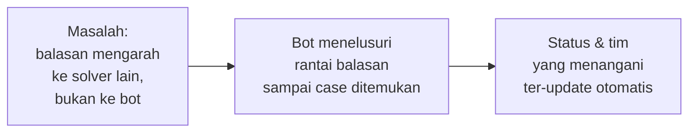
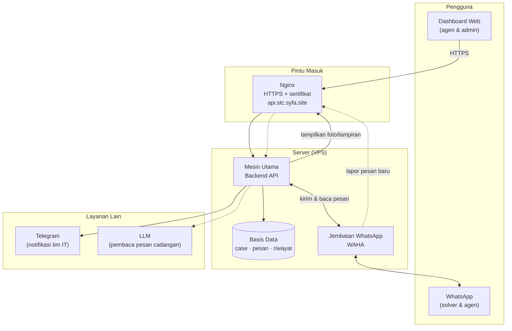
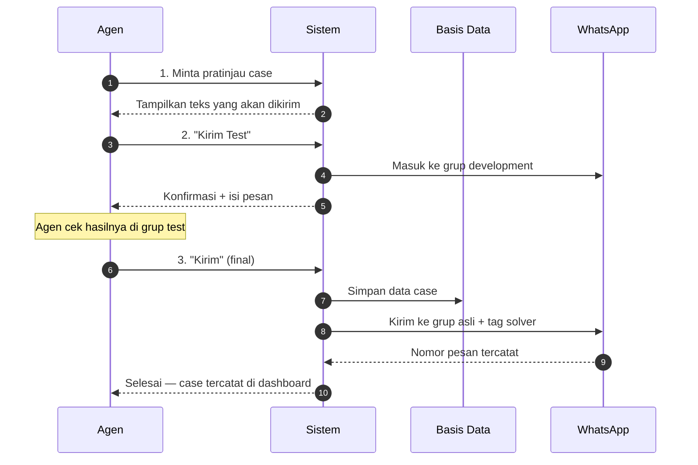
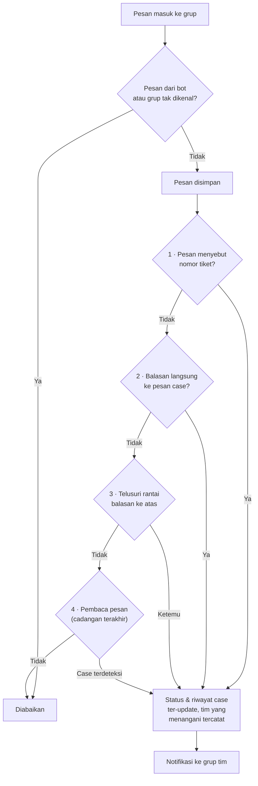
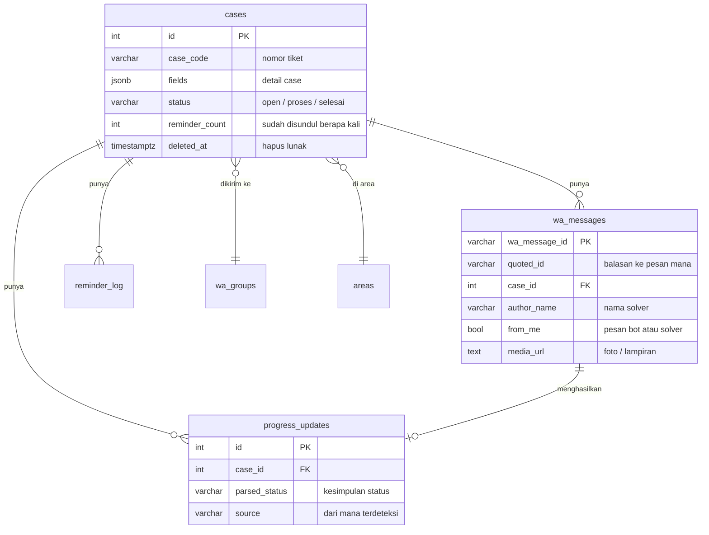
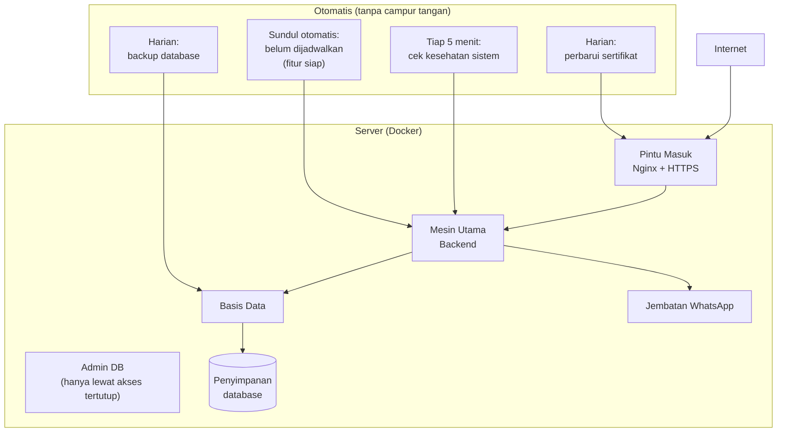
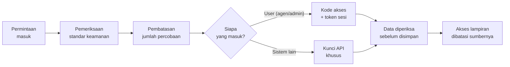
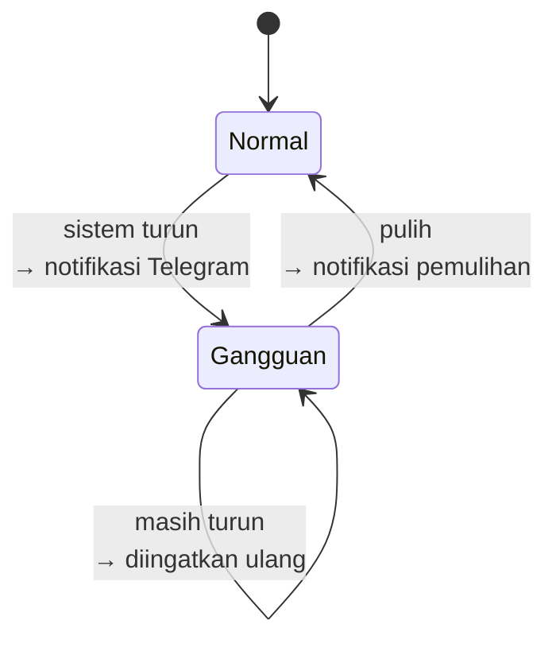

# IT Tracker — Pitch Deck

**11 slides** · Disusun 14 Oktober 2026
*Materi presentasi untuk manajemen — teknis disajikan secukupnya.*

> Cara pakai: render di [Marp](https://marp.app/) / [Slidev](https://sli.dev/) / Notion — `---` = pemisah slide.
> Tiap slide punya satu baris **▸ Dampak bisnis** — itu kalimat yang diucapkan saat slide dibuka. Detail teknis (istilah teknis, angka) jadi bahan jawaban kalau ditanya.

---

## Slide 1 — Masalah & Solusi

**Judul:** Follow-up case hilang di dalam grup WhatsApp

| Masalah | Akibat |
|---|---|
| Solver A menyerahkan case ke Solver B lewat balasan di grup | Agen tidak pernah tahu case-nya sudah selesai |
| Agen harus scroll grup untuk mencari kabar | Lambat, mudah terlewat |
| Format case diketik manual, berulang | Tulisan tidak konsisten, sulit dicari |

**Solusi:** Bot menjadi pencatat otomatis — case terkirim format rapi, status ter-update sendiri dari balasan solver, dan seluruh perjalanan case terekam.

**▸ Dampak bisnis:** agen berhenti scroll grup dan berhenti bertanya "case saya sudah selesai belum?" — jawabannya ada di dashboard.

---

## Slide 2 — Arsitektur Tingkat Tinggi

**▸ Dampak bisnis:** WhatsApp tetap jadi tempat kerja tim — tidak ada aplikasi baru yang harus dipelajari solver. Web hanya lapisan visibilitas untuk agen dan admin.

*Catatan teknis (kalau ditanya):* server database & mesin utama tidak bisa diakses langsung dari internet — hanya lewat pintu HTTPS. Lampiran (foto/dokumen) disimpan di server sendiri, jadi aman dari link kedaluwarsa.

---

## Slide 3 — Teknologi yang Dipakai

| Bagian | Teknologi | Kenapa dipilih |
|---|---|---|
| **Dashboard Web** | React (Vite, TypeScript) | Standar industri, mudah cari developer |
| **Mesin Utama** | FastAPI (Python) | Ringan, cepat, cocok menangani banyak pesan masuk bersamaan |
| **Basis Data** | PostgreSQL | Andal, gratis, sudah teruji di skala besar |
| **Jembatan WhatsApp** | WAHA | Menghubungkan WhatsApp resmi dengan sistem kami; bot tidak perlu "menyadap" aplikasi |
| **Keamanan** | JWT + API Key | Dua lapis: kode akses untuk user, kunci khusus untuk antar-sistem |
| **Notifikasi** | Telegram | Tim IT langsung tahu kalau ada gangguan |
| **Server** | Docker di VPS | Satu server, mudah dipindah & di-backup |

**▸ Dampak bisnis:** seluruh teknologi yang dipakai **open-source — tanpa lisensi berbayar**. Biaya rutin hanya server + domain.

---

## Slide 4 — Alur Kerja 1: Membuat Case

**Yang penting untuk tim operasional:**
- Agen bisa **cek dulu di grup test** sebelum case masuk grup asli — nol risiko salah kirim.
- Data case divalidasi **sebelum** pesan dikirim, jadi tidak ada case "nyangkut di grup tapi tidak tercatat" (perbaikan September 2026).
- Mengirim case dengan nomor tiket yang sama = **follow-up ulang**: case lama otomatis dibuka kembali, bukan bikin duplikat.

**▸ Dampak bisnis:** satu pintu input untuk semua jenis case, hasilnya seragam dan langsung tercatat.

---

## Slide 5 — Alur Kerja 2: Bagaimana Bot Menangkap Balasan Solver

**Cara bot bekerja — 4 tingkat, dari yang paling sederhana:**
1. **Nomor tiket** disebut → langsung cocok.
2. **Balasan langsung** ke pesan case → langsung cocok.
3. **Rantai balasan** (solver balas solver) → bot menelusuri ke atas sampai case ditemukan. **Ini inti pemecahan masalahnya.**
4. **Pembaca pesan otomatis** → hanya dipakai kalau 3 cara di atas gagal.

**▸ Dampak bisnis:** mayoritas kasus ditangani cara sederhana (1 & 2), jadi cepat dan gratis. Pembaca otomatis hanya pintu terakhir — itulah kenapa sistem tetap murah dioperasikan.

---

## Slide 6 — Data yang Disimpan

**Yang disimpan untuk setiap case:** nomor tiket, detail case, siapa saja yang terlibat, seluruh percakapan di grup, dan riwayat perubahan status.

- Hapus case bersifat **lunas-arsip** — data tidak hilang, hanya disembunyikan dari daftar (bisa dimunculkan lagi untuk audit).
- Grup WhatsApp **tersimpan sebagai referensi**, bukan salinan — nomor grup berubah pun tidak merusak data lama.

**▸ Dampak bisnis:** jejak lengkap setiap case tersedia untuk audit dan evaluasi kinerja, tanpa mengganggu percakapan di grup.

---

## Slide 7 — Cara Sistem Dijalankan (Operasional)

| Aspek | Kondisi saat ini |
|---|---|
| **Biaya server** | Satu VPS, satu domain |
| **Deploy / update** | Satu perintah, tanpa downtime yang terlihat pengguna |
| **Backup** | Otomatis harian, disimpan 14 hari |
| **Pemantauan** | Cek kesehatan tiap 5 menit; tim IT dapat notifikasi Telegram kalau ada gangguan |
| **Keamanan akses** | Database & server tidak terekspos ke internet |

**▸ Dampak bisnis:** operasional ringan — tidak perlu tim IT yang jaga 24 jam; sistem melapor sendiri kalau bermasalah.

---

## Slide 8 — Keamanan

| Kontrol | Penjelasan sederhana |
|---|---|
| **Kode akses** | Dashboard dilindungi login; sesi kedaluwarsa dalam 24 jam |
| **Kunci API** | Komunikasi antar-sistem diverifikasi, tidak bisa dipalsukan |
| **Anti brute-force** | Login dibatasi 5 percobaan/menit per alamat — kode tidak bisa ditebak berulang |
| **Verifikasi webhook** | Pesan yang masuk ke sistem wajib membawa tanda tangan rahasia |
| **Proteksi lampiran** | Sistem hanya mau mengambil file dari sumber WhatsApp yang sah |
| **Pesan error** | Tidak pernah membocorkan detail teknis ke pengguna |

**▸ Dampak bisnis:** data case dan percakapan **tidak pernah dibuka ke publik**; akses dashboard dibatasi kode akses yang bisa diganti kapan saja.

---

## Slide 9 — Pemantauan & Perawatan Otomatis

| Kapabilitas | Manfaat |
|---|---|
| **Cek kesehatan sistem** | Status database & jembatan WhatsApp terpantau tiap 5 menit |
| **Alert ke Telegram** | Tim IT diberi tahu saat sistem turun, saat masih turun, dan saat pulih |
| **Sundul otomatis** | Fitur siap di kedua sisi: tombol **sundul manual** aktif hari ini; penjadwalan berkala (>2 jam idle) **belum dinyalakan** oleh tim IT — tinggal dipasang |
| **Penelusuran riwayat** | Pesan lama di grup bisa dimasukkan ke sistem (backfill) |
| **Backup harian** | Data aman, bisa dipulihkan dalam 2 langkah |
| **Tambah grup baru** | Admin bisa lihat & daftarkan grup WhatsApp tanpa buka alat teknis |

**▸ Dampak bisnis:** masalah ketahuan dari sistem, bukan dari keluhan pengguna.

---

## Slide 10 — Hasil Terukur & Rencana Berikutnya

**Dua ukuran kinerja solver yang sudah tersedia:**

| Ukuran | Mengukur | Contoh pemanfaatan |
|---|---|---|
| **Kecepatan respon** | Dari case dikirim → balasan **pertama** solver | Menilai kesigapan solver menerima case |
| **Waktu penyelesaian** | Dari case dikirim → case **selesai** | Menilai berapa lama case benar-benar tuntas |

Keduanya bisa dilihat **per solver, per regional, per grup, dan per rentang tanggal** — dasar untuk evaluasi kinerja tim yang objektif.

> Catatan penting: penilaian memakai **nilai tengah (median)**, bukan rata-rata — supaya data lama hasil penelusuran tidak mendistorsi gambaran kinerja.

**Kondisi saat ini:**
- Seluruh tujuan awal sistem sudah tercapai (input konsisten, status otomatis, eskalasi terekam, riwayat bisa ditarik).
- Sistem sudah melewati **34 revisi** — stabil dan aktif dikembangkan.
- Uji otomatis rutin: **373 pemeriksaan** per rilis (372 lulus; 1 pemeriksaan gagal di komputer pengembang, tidak memengaruhi produksi).

**Rencana berikutnya:**
1. Notifikasi langsung ke agen saat case-nya selesai.
2. Kirim beberapa gambar sekaligus dalam satu balasan (mode galeri).
3. Dashboard: penyesuaian teknik pengambilan data agar tetap ringan saat jumlah case membesar.

**▸ Dampak bisnis:** sistem tidak hanya mencatat — ia menghasilkan **data kinerja solver yang bisa dipertanggungjawabkan**, dan sudah siap dikembangkan ke arah notifikasi proaktif.

---

## Slide 11 — Kapasitas, Keterbatasan & Mitigasi

**Beban sistem saat ini:**

| Ukuran | Angka | Catatan |
|---|---|---|
| Grup WhatsApp | **2 grup** | Ditambah kapan saja lewat panel admin |
| Case masuk | **108 case/bulan** (± 3–4 per hari kerja) | Terbagi rata ~54 case/grup/bulan |
| Kapasitas terpasang | 2 CPU · 2 GB RAM · 2 proses paralel | Dipakai jauh di bawah batas — masih longgar |
| Batas teknis dashboard | 120 permintaan/menit per pengguna | Pembatasan per alamat jaringan; cukup untuk pemakaian normal |
| Retensi data | Tidak terbatas (tanpa auto-hapus) | Hapus bersifat lunas-arsip, bisa dipulihkan |

> **Kesimpulan kapasitas:** pada beban saat ini (±108 case/bulan) sistem berjalan sangat longgar — pemakaian CPU dan memori jauh di bawah kapasitas terpasang. Ruang tumbuh besar sebelum perlu menambah server.

**Keterbatasan yang perlu diketahui manajemen:**

| # | Keterbatasan | Dampak | Mitigasi saat ini |
|---|---|---|---|
| 1 | **Dashboard belum real-time** — data diperbarui tiap 30 detik, bukan seketika | Status bisa terlihat telat ≤30 detik | Polling otomatis 30 detik + refresh saat tab dibuka kembali. Sudah ada rencana peningkatan |
| 2 | **Akses pakai kode akses bersama**, belum akun per-orang | Tidak bisa melacak siapa membuka dashboard | Kode terbatas & bisa diganti kapan saja; riwayat tindakan (ubah status, balas) tetap tercatat per case. Autentikasi per-user masuk rencana |
| 3 | **Satu server** — tidak ada server cadangan | Kalau VPS mati, sistem berhenti sampai dihidupkan | Backup otomatis harian (retensi 14 hari) + pemantauan tiap 5 menit. Pemulihan data bisa dalam hitungan menit |
| 4 | **Tergantung koneksi WhatsApp** | Kalau sesi WhatsApp terputus, pesan berhenti masuk | Sistem mendeteksi & memberi tahu tim IT; perbaikannya cukup scan ulang QR di WhatsApp — tanpa kehilangan data |

**▸ Dampak bisnis:** sistem cukup untuk beban kerja saat ini dengan **margin besar**, dan keempat keterbatasan di atas sudah diketahui beserta jalur penanganannya — tidak ada risiko tersembunyi.

---

## Lampiran — Fitur Utama Sistem

| Kelompok | Isi |
|---|---|
| **Input case** | Kirim ke grup WhatsApp, pratinjau sebelum kirim, mode test ke grup development |
| **Pemantauan** | Daftar case + filter (status, jenis, area, regional, grup, tanggal), pencarian bebas, ekspor ke Excel |
| **Detail case** | Riwayat percakapan lengkap + siapa saja yang menangani |
| **Tindakan** | Ubah status manual, balas solver dari dashboard, hapus (lunas-arsip) |
| **Referensi** | Data Area, Regional, Sumber Ticket, Jenis Case |
| **Kontak solver** | Daftar solver untuk keperluan tag/mention |
| **Grup WhatsApp** | Kelola daftar grup tujuan + deteksi grup baru |
| **Sundul** | Manual per case & otomatis terjadwal |
| **Lampiran** | Foto, video, dan dokumen ikut tampil di riwayat case |
| **Sistem** | Kesehatan sistem, alert Telegram, metrik kinerja solver, penelusuran riwayat |

> Untuk tim teknis: detail lengkap ada di `API-contract-frontend.md` v1.34 dan dokumentasi interaktif di `https://api.stc.syfa.site/docs`.
