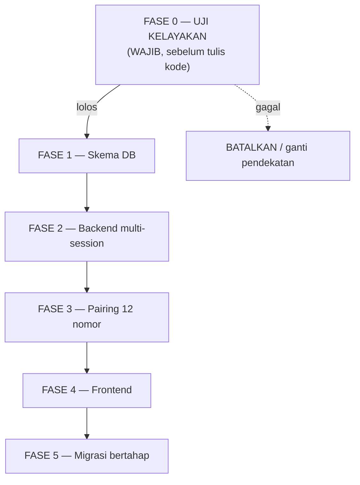

# Rencana: Multi-Nomor WA per Regional

**Status:** DRAFT — belum dieksekusi
**Tanggal:** 15 Oktober 2026
**Target:** 12 nomor (1 per regional) → kirim ke grup target yang sama, bisa dipilih nomornya
**Dasar:** `main-v1-1.py` v1.34.0, `schema-multi-group.sql`, dokumen resmi WAHA

> ⚠️ **Baca §5 (Dampak Jangka Panjang) SEBELUM memutuskan eksekusi.**
> Ada satu risiko yang bisa membatalkan seluruh rencana ini, dan itu **bukan** soal kode.

---

## 1. Ringkasan Masalah Teknis

Saat ini arsitektur mengasumsikan **satu nomor WhatsApp**:

```python
# main-v1-1.py:60
WAHA_SESSION = os.getenv("WAHA_SESSION", "default")
```

Nilai global ini dipakai di **11 tempat** (semua operasi WA). Artinya: semua case keluar dari satu nomor, dan webhook yang masuk tidak bisa dibedakan asalnya dari nomor mana.

WAHA sendiri **mendukung multi-session** (dokumentasi resmi: *"scale it to 500 sessions"*), jadi batasannya ada di kode & data kita, bukan di WAHA.

---

## 2. Perubahan yang Dibutuhkan

### 2.1 Skema Database (migration baru)

```sql
-- File baru: schema-migration-sessions.sql

-- 1. Daftar nomor WA (session WAHA)
CREATE TABLE IF NOT EXISTS wa_sessions (
    id            SERIAL PRIMARY KEY,
    name          VARCHAR(64) NOT NULL UNIQUE,   -- nama session di WAHA, mis. "regional-1"
    label         VARCHAR(100) NOT NULL,          -- tampilan UI, mis. "Regional 1 - Jakarta"
    phone_number  VARCHAR(20),                    -- 628xxx, diisi setelah pairing
    is_active     BOOLEAN NOT NULL DEFAULT true,
    created_at    TIMESTAMPTZ DEFAULT now(),
    updated_at    TIMESTAMPTZ DEFAULT now()
);

-- 2. Nomor mana yang dipakai untuk grup mana
ALTER TABLE wa_groups ADD COLUMN IF NOT EXISTS session_id INT
    REFERENCES wa_sessions(id) ON DELETE SET NULL;
CREATE INDEX IF NOT EXISTS idx_wa_groups_session ON wa_groups(session_id);

-- 3. Simpan session per case (untuk mencocokkan balasan & reminder)
ALTER TABLE cases ADD COLUMN IF NOT EXISTS session_id INT
    REFERENCES wa_sessions(id) ON DELETE SET NULL;
CREATE INDEX IF NOT EXISTS idx_cases_session ON cases(session_id);

-- 4. Simpan session per pesan (webhook masuk dari nomor mana)
ALTER TABLE wa_messages ADD COLUMN IF NOT EXISTS session_id INT
    REFERENCES wa_sessions(id) ON DELETE SET NULL;
CREATE INDEX IF NOT EXISTS idx_wamsg_session ON wa_messages(session_id);
```

**Catatan penting:** `cases` dan `wa_messages` **wajib** menyimpan session. Kalau tidak, saat balasan solver masuk kita tidak tahu nomor mana yang harus dipakai membalas — dan reply-chain bisa putus.

### 2.1a Bentuk Payload Webhook (terverifikasi dari dokumen resmi WAHA)

`session` ada di **level root** event, bersaudara dengan `event` dan `payload`:

```jsonc
{
  "event": "message",
  "session": "default",          // ← nama session asal pesan
  "payload": {
    "id": "false_..._BBB",
    "from": "120363xxx@g.us",
    "body": "done mas",
    "replyTo": { "id": "..." }
  }
}
```

Kode saat ini (`waha_webhook`, `main-v1-1.py:2664`) hanya membaca `data["event"]` dan `data["payload"]` — `data["session"]` diabaikan. Itu titik masuk perubahan #6.

### 2.2 Perubahan Kode (`main-v1-1.py`)

| # | Lokasi | Sekarang | Menjadi |
|---|---|---|---|
| 1 | `:322 waha_send()` | Baca `WAHA_SESSION` global | Tambah param `session: str \| None = None`, fallback ke global |
| 2 | `:1298 waha_send_media()` | Terima payload mentah | Pemanggil yang menyuplai `session` |
| 3 | `:2035` (notif grup test) | `WAHA_SESSION` | Session dari case |
| 4 | `:774` (notif update case) | `WAHA_SESSION` | Session dari case |
| 5 | `:1100 handle_message()` | `_get_group_by_chat(from)` | Tambah filter session: `_get_group_by_chat(from, session)` |
| 6 | `:2685 waha_webhook()` | Tidak baca session | Baca `data["session"]` (**level root event**, bukan di dalam `payload`) → teruskan ke handler |
| 7 | `:886 _get_group()` dkk | Filter by id saja | Tambah opsi filter session |
| 8 | `:1402-1520` create/test-send | Pakai session global | Resolve session dari grup yang dipilih |
| 9 | `:1912, :1991, :2087` (reply/reminder) | Session global | Session dari `case["session_id"]` |
| 10 | `:2976, :3074` (discovery & crawl) | Session global | **Loop per session** untuk crawl semua grup |
| 11 | `:383, :401, :444, :460` (resolve kontak LID) | Session global | Kontak di-cache **per session** |

**Poin #4 & #5 adalah yang paling rawan.** Kalau webhook tidak difilter per session, pesan dari nomor A bisa dikaitkan ke case nomor B — dan sistem akan mengirim balasan dari nomor yang salah ke grup.

### 2.3 Perubahan API (kontrak frontend)

- `POST /api/cases` → tambah field opsional `session_id`
- `GET /api/groups` → response tambah `session_id` + `session_label`
- **Endpoint baru** `GET/POST/PUT /api/sessions` (CRUD nomor) — untuk admin
- `GET /api/waha/sessions` — daftar session dari WAHA lengkap status (mirip pola `/api/waha/groups` yang sudah ada)
- Kontrak naik ke **v1.35** + changelog

### 2.4 Frontend

- Dropdown pemilihan nomor di form create case (bisa di bawah switcher grup)
- Halaman admin kelola nomor (tambah, aktif/nonaktif, lihat status QR)
- Badge nomor pengirim di dashboard (biar agen tahu case ini keluar dari nomor mana)

---

## 3. Urutan Eksekusi yang Disarankan



### FASE 0 — Uji Kelayakan (WAJIB lebih dulu)

Jangan tulis satu baris kode pun sebelum ini lolos:

1. **Uji 3 session** di VPS 2 core / 2 GB → ukur RAM & CPU saat idle dan saat kirim. Ekstrapolasi ke 12.
2. **Uji kirim dari 2 nomor berbeda ke grup yang sama** → cek apakah kena error `463` (Reachout Timelock) atau `475` (Message Capping).
3. **Uji webhook** dengan 2 session aktif → pastikan `payload.session` benar-benar terisi dan bisa dibedakan.

**Kriteria lolos:** RAM masih ada sisa ≥30% setelah 3 session + kirim ke grup yang sudah dikenal.

### FASE 1–5
Setelah Fase 0 lolos:
- **Fase 1:** migration SQL + isi `wa_sessions` (1 baris: session existing `default`)
- **Fase 2:** refactor 11 titik kode + test (target: semua test lama tetap hijau)
- **Fase 3:** pairing 12 nomor secara bertahap — jangan 12 sekaligus, uji 2 dulu
- **Fase 4:** FE menyusul (bisa paralel dengan Fase 3)
- **Fase 5:** migrasi case lama → semua `session_id` di-set ke session existing

---

## 4. Concern Sebelum Eksekusi

| # | Concern | Kenapa penting | Tindakan |
|---|---|---|---|
| C1 | **RAM tidak cukup** | WEBJS = Chrome headless per session. 12 × Chrome di 2 GB hampir pasti tidak muat | Ukur di Fase 0. Kalau gagal → naikkan VPS atau pakai engine lebih ringan (NOWEB/GOWS) |
| C2 | **WhatsApp limit ke kontak baru** | `463`/`475` bisa memblokir kirim ke grup | Uji di Fase 0. Pastikan 12 nomor sudah join grup & pernah kirim sebelumnya |
| C3 | **12 nomor harus join grup yang sama** | Pekerjaan manual + batas anggota grup WhatsApp | Konfirmasi dulu: grup target sanggup menampung 12 nomor tambahan? |
| C4 | **Reply-chain bisa putus** | Balasan masuk dari session berbeda → case tidak ketemu | Wajib simpan `session_id` di `cases` & `wa_messages` (§2.1) |
| C5 | **Resolve kontak/LID per session** | LID berbeda antar nomor | Cache kontak harus di-key per session (§2.2 poin 11) |
| C6 | **12 QR harus di-scan ulang** | Session hilang kalau volume terhapus | Named volume `waha_waha_sessions` **jangan** dihapus saat maintenance |
| C7 | **Crawl jadi 12× lebih berat** | Crawl loop per session | Batasi crawl ke grup/session terpilih, jangan "semua" |
| C8 | **Nomor bisa kena ban** | WhatsApp tidak suka pola otomasi | Pisahkan nomor bot dari nomor pribadi; siapkan nomor cadangan |
| C9 | **Kompleksitas operasional** | 12 session = 12 titik gagal | Health check sudah baca semua session ✅ — tapi alert harus per-session |
| C10 | **Tidak ada jalur balik** | Setelah case tersebar di 12 nomor, sulit kembali ke 1 | Tetapkan sejak awal: apakah multi-nomor ini permanen? |

---

## 5. Dampak Jangka Panjang (PENTING)

### 5.1 Risiko terbesar: WhatsApp bisa memblokir semua nomor

Ini bukan risiko teoretis. WhatsApp secara aktif membatasi akun yang mengirim ke banyak **kontak/grup baru**:

- **Reachout Timelock** → error `463`, sampai batas waktu tertentu
- **Message Capping** → error `475`, kuota per siklus (contoh: 1000 pesan ke chat baru)

**Skenario terburuk:** 12 nomor mengirim ke **grup yang sama** → dari sudut pandang WhatsApp, itu 12 akun berbeda mengirim ke pola yang identik. Ini bisa terbaca sebagai perilaku bot, dan **akun bisa diblokir permanen**.

Kalau satu nomor diblokir → regional itu kehilangan kanal. Kalau 12 diblokir → **seluruh sistem berhenti**.

> **Rekomendasi:** uji dengan 2 nomor dulu, amati beberapa minggu, baru tambah bertahap. Jangan langsung 12.

### 5.2 Biaya operasional naik permanen

| Aspek | Sekarang (1 nomor) | Nanti (12 nomor) |
|---|---|---|
| Nomor & kartu | 1 | 12 (biaya bulanan kartu) |
| Beban VPS | Ringan | Berat — kemungkinan perlu upgrade |
| Pemantauan | 1 session | 12 session, masing-masing bisa mati sendiri |
| Perbaikan jika QR hilang | 1 scan | 12 scan, masing-masing perlu orang |
| Maintenance WAHA | 1 | Tetap 1 container ✅ (WAHA handle multi-session) |

**Yang tidak naik:** jumlah container WAHA tetap 1 — itu keuntungan arsitektur WAHA.

### 5.3 Kompleksitas kode & debugging naik signifikan

Hari ini semua fungsi WA membaca satu variabel global. Setelah perubahan:
- Setiap operasi WA harus tahu **session mana** yang dipakai
- Setiap bug harus dicek: apakah masalahnya di grup, case, atau session?
- Reply-chain punya satu sumbu baru yang bisa salah

Ini menaikkan biaya perawatan untuk **selamanya**, bukan cuma saat pembuatan.

### 5.4 Manfaatnya nyata, tapi terbatas

**Yang didapat:**
- Solver/agen langsung tahu case berasal dari regional mana (dari nomor pengirim)
- Beban kirim terbagi antar nomor — mengurangi risiko satu nomor kena limit
- Lebih rapi secara organisasi (1 regional = 1 kanal)

**Yang TIDAK didapat:**
- Tidak menambah fitur baru untuk solver/agen (mereka tetap lihat grup yang sama)
- Tidak menyelesaikan masalah tracking — itu sudah beres di arsitektur saat ini
- Tidak mengurangi jumlah case yang harus ditangani

> **Pertanyaan kunci:** apakah manfaat "nomor berbeda per regional" sebanding dengan 5 risiko permanen di atas? Kalau tujuannya hanya **penanda visual** (case dari regional mana), itu bisa dicapai dengan cara **jauh** lebih murah — misalnya menambahkan label regional di header pesan yang sudah ada (`#Area_Regional` sudah ada di format pesan, lihat §3.2 kontrak).

### 5.5 Alternatif yang lebih murah

| Opsi | Cara | Biaya | Risiko |
|---|---|---|---|
| **A. Tetap 1 nomor** (status quo) | Label regional sudah ada di header pesan | 0 | 0 |
| **B. 2–3 nomor saja** (mis. per kelompok besar) | Kompromi: pembagian beban, tanpa 12 titik gagal | Sedang | Sedang |
| **C. 12 nomor** (rencana ini) | Perlu Fase 0 lolos dulu | Tinggi | Tinggi |

**Rekomendasi saya:** mulai dari **Opsi A** (pastikan label regional yang sudah ada benar-benar terpakai di UI), ukur apakah itu sudah menjawab kebutuhan. Kalau belum, naik ke **Opsi B**. **Opsi C** hanya kalau ada kebutuhan bisnis yang tidak bisa dipenuhi cara lain.

---

## 6. Keputusan yang Perlu Diambil Sebelum Eksekusi

1. **Apa kebutuhan bisnis sebenarnya?** Kalau hanya "agar terlihat dari regional mana" → tidak perlu 12 nomor.
2. **Apakah grup target sanggup menampung 12 nomor tambahan?** (batas anggota grup)
3. **Siapa yang mengelola 12 QR scan** kalau ada session putus? Ada orang jaga?
4. **Siap upgrade VPS** kalau Fase 0 menunjukkan RAM tidak cukup?
5. **Apa rencana kalau ada nomor kena ban?** Ada nomor cadangan?

Kalau kelima poin ini belum terjawab, **jangan eksekusi**. Fase 0 bisa dijalankan tanpa komitmen — hanya mengukur, tidak mengubah apa pun.

---

## 7. Estimasi Pekerjaan (setelah Fase 0 lolos)

| Fase | Isi | Perkiraan |
|---|---|---|
| 1 | Migration DB + seed | Kecil |
| 2 | Refactor 11 titik + test | **Besar** (risiko regresi tertinggi) |
| 3 | Pairing 12 nomor (bertahap) | Sedang, tapi butuh waktu tunggu observasi |
| 4 | Frontend | Sedang |
| 5 | Migrasi data lama | Kecil |

**Total:** bukan pekerjaan sehari. Fase 2 adalah inti — dan setiap perubahan di sana berpotensi memutus reply-chain yang sudah bekerja dengan baik.
